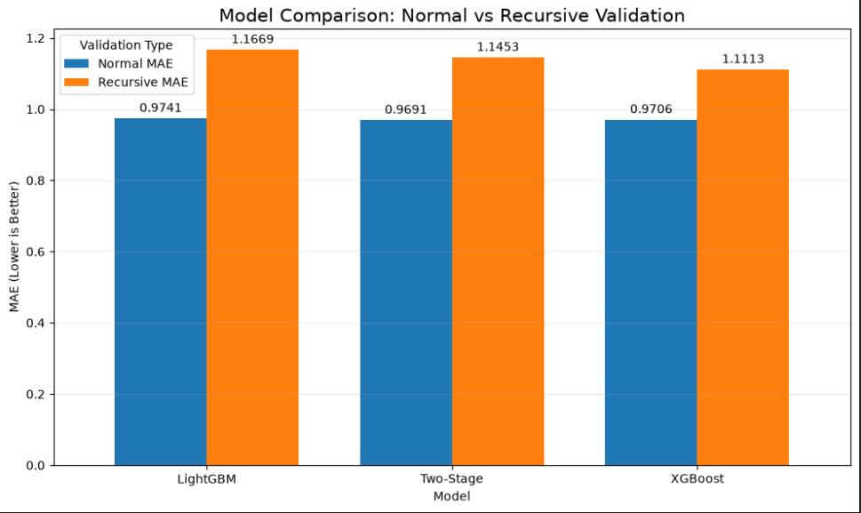

# Store-Level Demand Forecaster

This project explores and forecasts daily retail unit sales for item/store series using the M5 Forecasting dataset. The workflow is implemented in two Jupyter notebooks: exploratory data analysis and feature creation, followed by model experiments, final training, and a recursive 28-day forecast.

## Project files

```text
.
├── EDA.ipynb                 # Dataset exploration, feature engineering, and model-ready data
├── model.ipynb               # Baselines, model experiments, training, and forecasting
├── data/
│   ├── raw/                  # M5 source CSV files and intermediate training features
│   └── model_ready/          # Engineered features, feature configuration, forecast output
└── models/
    ├── final_xgboost.json    # Trained XGBoost model used for forecasting
    └── xgb_cache/            # XGBoost external-memory training cache
```

The M5 competition's raw sales and price data and large engineered feature tables are not stored in Git. Download `sales_train_evaluation.csv`, `calendar.csv`, and `sell_prices.csv` from the [Kaggle M5 Forecasting Accuracy competition](https://www.kaggle.com/competitions/m5-forecasting-accuracy/data) and place them in `data/raw/` to rerun feature preparation or model training. The small calendar file and the saved forecast outputs used by the dashboard are included.

## Workflow

### 1. Explore and prepare the data

Run `EDA.ipynb` from top to bottom. It loads the sales, calendar, and sell-price CSVs and explores sales patterns, missing values, price and event effects, and demand behavior. It then:

- Prepares the daily item/store sales data and joins calendar and price information.
- Engineers calendar, price, lag, rolling-window, and demand-related features.
- Examines feature availability and uses a time-based 28-day holdout.
- Saves the engineered modeling dataset and feature configuration under `data/model_ready/`.

The notebook expects these source files in `data/raw/`:

- `sales_train_evaluation.csv`
- `calendar.csv`
- `sell_prices.csv`

### 2. Train and forecast

Run `model.ipynb` from top to bottom after preparing the data. It compares moving-average baselines with LightGBM, XGBoost, and SARIMAX experiments, evaluates validation performance, and inspects XGBoost feature importance. The final XGBoost training uses batched Parquet input and an external-memory cache to handle the large feature dataset.

The final forecasting section predicts days `d_1914`–`d_1941` (28 days). It updates lag and rolling features with each day's predictions, rather than using actual future sales as inputs. It evaluates predictions against the available actuals and saves them to:

```text
data/model_ready/final_forecast_d1914_d1941.parquet
```

The forecasting section loads `models/final_xgboost.json`. Generate this model by running the training section of `model.ipynb`, or provide the model file at that path before running the forecast section.

## Setup

Use a Python environment with Jupyter and the notebook dependencies installed:

```bash
pip install jupyter pandas numpy matplotlib seaborn pyarrow scikit-learn xgboost lightgbm "dask[distributed]" shap statsmodels
jupyter notebook
```

Open `EDA.ipynb` first, then `model.ipynb`. Run the notebooks with the repository root as the working directory so their relative data and model paths resolve correctly. The XGBoost training and feature dataset require substantial disk space and memory.

## Model comparison and selection

The validation comparison below reports MAE for both normal validation (features are built from the observed history) and recursive validation (each prediction is fed back into the history for the next forecast day). Lower MAE is better.



| Model | Normal validation MAE | Recursive validation MAE |
| --- | ---: | ---: |
| LightGBM | 0.9741 | 1.1669 |
| Two-Stage (sale occurrence + sale size) | **0.9691** | 1.1453 |
| XGBoost | 0.9706 | **1.1113** |

XGBoost was selected for the final forecast because recursive validation is the closer match to the intended multi-day use: future sales are unknown, so the model must use its own earlier predictions to build subsequent lag and rolling features. XGBoost has the lowest recursive MAE in this comparison (1.1113), about 3.0% lower than Two-Stage (1.1453) and 4.8% lower than LightGBM (1.1669).

This is a metric-based trade-off, not a claim that XGBoost is best in every setting. Two-Stage has the best normal-validation MAE (0.9691), only 0.0015 below XGBoost (0.9706), but its recursive MAE is higher. The Two-Stage approach also requires a sale-occurrence classifier and a conditional sale-size regressor, while the selected XGBoost pipeline uses one regressor for the recursive forecast. Given the substantially better recursive result and simpler final prediction path, XGBoost is the choice for this project.

## Evaluation note

The saved forecast in `data/model_ready/final_forecast_d1914_d1941.parquet` covers `d_1914`–`d_1941` and contains predictions and actual sales for 30,490 item/store series. Recalculated from this file, its metrics are MAE `1.0638`, RMSE `2.2942`, WAPE `73.73%`, and mean bias `-0.1908` (prediction minus actual). These are holdout-period results, not a forecast of dates beyond the available actuals.

On the same holdout, a fixed baseline equal to each series' mean sales over `d_1886`–`d_1913` produced MAE `1.0657`, RMSE `2.2430`, WAPE `73.86%`, and mean bias `-0.0564`.

| Method | MAE | RMSE | WAPE | Mean bias |
| --- | ---: | ---: | ---: | ---: |
| XGBoost | 1.0638 | 2.2942 | 73.7308% | -0.1908 |
| Fixed 28-day mean baseline | 1.0657 | 2.2430 | 73.8643% | -0.0564 |

The methods are close on this one holdout: XGBoost has slightly lower MAE and WAPE, while the baseline has lower RMSE and bias closer to zero. This single period does not establish that either method will perform better across other periods. The model comparison above uses a separate validation result and should be interpreted separately.

To recalculate these metrics, run only a notebook cell that reads the saved forecast Parquet and computes the metrics; do not use **Run All** unless you intend to rerun feature preparation and model training. The saved forecast already contains the values needed for evaluation.

## Rolling evaluation and future forecast

The optional `extended_workflows.py` script runs these workflows independently of the notebook:

```bash
python extended_workflows.py backtest
python extended_workflows.py future
```

The rolling backtest evaluates three recursive 28-day periods: `d_1858`–`d_1885`, `d_1886`–`d_1913`, and `d_1914`–`d_1941`. It trains models through each period's cutoff (reusing the saved model trained through `d_1913` for the last fold when its feature count and round count match) and compares them with a fixed mean of the preceding 28 actual days. Results are written to `data/model_ready/rolling_backtest_metrics.csv`. Each fold's XGBoost training uses the existing 150-round, external-memory configuration and may take substantial time.

The future workflow trains a separate XGBoost model using data through `d_1941`, leaving `models/final_xgboost.json` unchanged. It recursively predicts `d_1942`–`d_1969` from the available calendar and sell-price data and saves the model to `models/final_xgboost_d1941.json` and predictions to `data/model_ready/future_forecast_d1942_d1969.parquet`. These are M5 competition dates; actual sales for this forecast period are not included in the evaluation sales file, so these predictions cannot be scored here.

Run both workflows with `python extended_workflows.py all`. Training is computationally intensive; it does not rerun EDA or the full notebook.

### Completed rolling backtest

The three completed folds produced these results:

| Validation period | Method | MAE | RMSE | WAPE | Mean bias |
| --- | --- | ---: | ---: | ---: | ---: |
| `d_1858`–`d_1885` | XGBoost | 1.0401 | 2.3532 | 75.5032% | -0.1487 |
| `d_1858`–`d_1885` | 28-day mean baseline | 1.0458 | 2.3073 | 75.9124% | -0.0005 |
| `d_1886`–`d_1913` | XGBoost | 1.0383 | 2.2515 | 74.8870% | -0.1415 |
| `d_1886`–`d_1913` | 28-day mean baseline | 1.0411 | 2.2186 | 75.0943% | -0.0089 |
| `d_1914`–`d_1941` | XGBoost | 1.0638 | 2.2942 | 73.7308% | -0.1908 |
| `d_1914`–`d_1941` | 28-day mean baseline | 1.0657 | 2.2430 | 73.8643% | -0.0564 |

XGBoost has slightly lower MAE and WAPE in all three folds, while the baseline has lower RMSE and bias closer to zero in all three. The MAE and WAPE differences are small, so this evidence supports XGBoost as a reasonable candidate but not as a decisive improvement over the simple baseline.

The generated future forecast contains 853,720 predictions: 30,490 series for each day from `d_1942` through `d_1969`. Predictions are non-negative and complete in the saved Parquet file. Since actual sales for those dates are unavailable in the supplied data, this forecast is not an accuracy evaluation.

## Interactive dashboard

The Streamlit dashboard uses plain-language date ranges (for example, May 23–June 19, 2016) instead of dataset day codes. It lets users explore estimates by product type, store, and item; compare estimated and actual sales for a past test period; and understand model accuracy without working with notebooks. The final-period M5 projection is clearly marked as a historical example, not a live forecast.

From the project directory, install the dashboard dependencies and start the app:

```powershell
python -m pip install -r requirements-app.txt
python -m streamlit run app.py
```

The app reads the saved Parquet and CSV outputs; it does not retrain the model. The M5 final-period forecast is a historical dataset forecast, not current real-world demand guidance.
