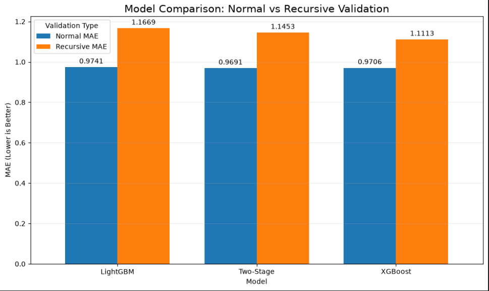

# Store-Level Demand Forecaster

This project explores and forecasts daily retail unit sales for item/store series using the M5 Forecasting dataset. It includes notebook-based experiments and a recursive XGBoost forecast, plus a separate horizon-aware direct XGBoost candidate, data-quality checks, a FastAPI service, and a Streamlit dashboard.

## Project files

```text
.
├── EDA.ipynb                 # Dataset exploration, feature engineering, and model-ready data
├── model.ipynb               # Baselines, model experiments, training, and forecasting
├── direct_forecasting.py     # Direct 1–28-day XGBoost training, forecasting, evaluation
├── forecasting_service.py    # Joblib model bundle, CSV validation, reusable inference
├── training_jobs.py          # Start and monitor background dashboard training jobs
├── training_job_runner.py    # Validate and save versioned model/forecast artifacts
├── data_quality.py           # M5 schema, key, date, and value checks
├── inventory.py              # Validated replenishment scenario calculations
├── api.py                    # FastAPI forecasts, analytics, and simulation endpoints
├── MODEL_CARD.md             # Intended use, evidence, and limitations
├── tests/                    # Focused automated tests
├── data/
│   ├── raw/                  # M5 source CSV files and intermediate training features
│   └── model_ready/          # Engineered features, feature configuration, forecast output
└── models/
    ├── final_xgboost.json    # Trained XGBoost model used for forecasting
    └── xgb_cache/            # XGBoost external-memory training cache
```

The M5 competition's raw sales and price data and large engineered feature tables are not stored in Git. Download `sales_train_evaluation.csv`, `calendar.csv`, and `sell_prices.csv` from the [Kaggle M5 Forecasting Accuracy competition](https://www.kaggle.com/competitions/m5-forecasting-accuracy/data) and place them in `data/raw/` to rerun feature preparation or model training. The small calendar file and the saved forecast outputs used by the dashboard are included.

## Quick start: run the existing frontend

Open PowerShell in the project folder (the inner `Store-level-demand-forcaster` directory):

```powershell
cd C:\Users\acer.DESKTOP-F8EJN0N\Store_level_demand\Store-level-demand-forcaster
python -m pip install -r requirements-app.txt
python -m streamlit run app.py
```

Open the `Local URL` printed by Streamlit, usually `http://localhost:8501`. Stop the app with **Ctrl+C**.

On the first forecast request, the dashboard packages the existing `models/final_xgboost_d1941.json` model as `models/recursive_xgboost.joblib` if the bundle is missing. This packages an already-trained model; it does not retrain. The app caches the loaded model while running and reuses it on later requests and app reruns. If that model artifact is unavailable, create the bundle explicitly with `python .\forecasting_service.py package-existing`.

Choose **Explore sales estimates** and upload a recent daily-sales CSV with columns `id,date,sales`; `sell_price` is optional. Re-uploaded `id,date` pairs update saved local history. The app keeps actual sales and future predictions in separate charts and saves the forecast and provenance under `data/user_data/`. It refuses to present the old 2016 M5 example projection as a current forecast.

Every series uses recursive XGBoost when the saved model's numeric feature schema is compatible; the series ID does not have to match an M5 ID. At least 28 consecutive daily observations are required. If fewer than 56 days are available, the unavailable `lag_56` is passed as missing (not replaced by zero), which the trained XGBoost model supports. Forecasting or model errors are reported rather than silently replaced with a constant-average forecast. Forecast dates are generated after the newest observed date and must be current (the latest input date cannot be older than yesterday). For dates beyond the M5 calendar, calendar events and SNAP are set to zero and the last known price is carried forward; predictions should be reviewed carefully.

### How the pieces connect

```text
M5 history -> one-time training (not triggered by the dashboard)
           -> XGBoost model + feature schema -> joblib model bundle

recent sales CSV -> validate/update local history -> reuse cached joblib model
                 -> 28-day future forecast + metadata -> separate actual/forecast charts
```

`model.ipynb` is the original model experimentation and training workflow. The dashboard loads its already-trained recursive XGBoost artifact; opening the app, uploading data, or requesting a forecast never trains automatically. **Train and save M5 forecast** offers two explicit manual retraining options:

- **Train from saved uploaded sales** uses the saved local upload history, requires at least 90 consecutive daily observations for eligible series and at least 1,000 generated training examples, then activates a versioned `.joblib` model. For bounded runtime, it samples at most 10,000 series and uses up to the latest 28 eligible target days per series. It reuses the configured feature schema and records the training-data hash and date range in model metadata.
- **Retrain on the full M5 training dataset** launches the existing background M5 training workflow. It requires the local M5 source and engineered-feature files and may take a long time.

Both options require an explicit confirmation; neither is triggered by an upload or forecast request. The active model pointer is stored under `models/active_recursive_xgboost.json`. Keep the prior bundle if you may want to roll back. Models trained on a small or unrepresentative set of uploaded series may not generalize well; evaluate a newly trained model before relying on its predictions.

The upload schema is deliberately explicit: `id` is a stable product/store series key, `date` is a daily date, `sales` is a finite non-negative unit count, and optional `sell_price` is a positive price. The local history merges successive uploads, with the newest value replacing an existing row for the same `id,date`. Upload files must have a common latest date across included series. User uploads and forecasts are local and excluded from Git.

## Workflow

### 1. Explore and prepare the data

Run `EDA.ipynb` from top to bottom. It loads the sales, calendar, and sell-price CSVs and explores sales patterns, missing values, price and event effects, and demand behavior. It then:

- Prepares the daily item/store sales data and joins calendar and price information.
- Engineers calendar, price, lag, rolling-window, and demand-related features.
- Examines feature availability and uses a time-based 28-day holdout.
- Saves the engineered modeling dataset and feature configuration under `data/model_ready/`.

The notebook expects these source files in `data/raw/`:

- `sales_train_evaluation.csv`
- `calendar.csv`
- `sell_prices.csv`

### 2. Train and forecast

Run `model.ipynb` from top to bottom after preparing the data. It compares moving-average baselines with LightGBM, XGBoost, and SARIMAX experiments, evaluates validation performance, and inspects XGBoost feature importance. The final XGBoost training uses batched Parquet input and an external-memory cache to handle the large feature dataset.

The final forecasting section predicts days `d_1914`–`d_1941` (28 days). It updates lag and rolling features with each day's predictions, rather than using actual future sales as inputs. It evaluates predictions against the available actuals and saves them to:

```text
data/model_ready/final_forecast_d1914_d1941.parquet
```

The forecasting section loads `models/final_xgboost.json`. Generate this model by running the training section of `model.ipynb`, or provide the model file at that path before running the forecast section.

## Setup

For notebook-based feature preparation and model training, use a Python environment with Jupyter and the notebook dependencies installed. Dashboard/API dependencies are listed separately in `requirements-app.txt`.

```bash
python -m pip install jupyter pandas numpy matplotlib seaborn pyarrow scikit-learn xgboost lightgbm "dask[distributed]" shap statsmodels
python -m pip install -r requirements-app.txt
python -m jupyter notebook
```

Open `EDA.ipynb` first, then `model.ipynb`. Run the notebooks with the project root as the working directory so their relative data and model paths resolve correctly. Feature preparation and XGBoost training are separate from launching the frontend and may require substantial time, memory, and disk space. Do not select **Run All** simply to view existing forecasts.

## Model comparison and selection

The validation comparison below reports MAE for both normal validation (features are built from the observed history) and recursive validation (each prediction is fed back into the history for the next forecast day). Lower MAE is better.



| Model | Normal validation MAE | Recursive validation MAE |
| --- | ---: | ---: |
| LightGBM | 0.9741 | 1.1669 |
| Two-Stage (sale occurrence + sale size) | **0.9691** | 1.1453 |
| XGBoost | 0.9706 | **1.1113** |

XGBoost was selected for the final forecast because recursive validation is the closer match to the intended multi-day use: future sales are unknown, so the model must use its own earlier predictions to build subsequent lag and rolling features. XGBoost has the lowest recursive MAE in this comparison (1.1113), about 3.0% lower than Two-Stage (1.1453) and 4.8% lower than LightGBM (1.1669).

This is a metric-based trade-off, not a claim that XGBoost is best in every setting. Two-Stage has the best normal-validation MAE (0.9691), only 0.0015 below XGBoost (0.9706), but its recursive MAE is higher. The Two-Stage approach also requires a sale-occurrence classifier and a conditional sale-size regressor, while the selected XGBoost pipeline uses one regressor for the recursive forecast. Given the substantially better recursive result and simpler final prediction path, XGBoost is the choice for this project.

## Evaluation note

The saved forecast in `data/model_ready/final_forecast_d1914_d1941.parquet` covers `d_1914`–`d_1941` and contains predictions and actual sales for 30,490 item/store series. Recalculated from this file, its metrics are MAE `1.0638`, RMSE `2.2942`, WAPE `73.73%`, and mean bias `-0.1908` (prediction minus actual). These are holdout-period results, not a forecast of dates beyond the available actuals.

On the same holdout, a fixed baseline equal to each series' mean sales over `d_1886`–`d_1913` produced MAE `1.0657`, RMSE `2.2430`, WAPE `73.86%`, and mean bias `-0.0564`.

| Method | MAE | RMSE | WAPE | Mean bias |
| --- | ---: | ---: | ---: | ---: |
| XGBoost | 1.0638 | 2.2942 | 73.7308% | -0.1908 |
| Fixed 28-day mean baseline | 1.0657 | 2.2430 | 73.8643% | -0.0564 |

The methods are close on this one holdout: XGBoost has slightly lower MAE and WAPE, while the baseline has lower RMSE and bias closer to zero. This single period does not establish that either method will perform better across other periods. The model comparison above uses a separate validation result and should be interpreted separately.

To recalculate these metrics, run only a notebook cell that reads the saved forecast Parquet and computes the metrics; do not use **Run All** unless you intend to rerun feature preparation and model training. The saved forecast already contains the values needed for evaluation.

## Rolling evaluation and future forecast

The optional `extended_workflows.py` script runs these workflows independently of the notebook:

```bash
python extended_workflows.py backtest
python extended_workflows.py future
```

The rolling backtest evaluates three recursive 28-day periods: `d_1858`–`d_1885`, `d_1886`–`d_1913`, and `d_1914`–`d_1941`. It trains models through each period's cutoff (reusing the saved model trained through `d_1913` for the last fold when its feature count and round count match) and compares them with a fixed mean of the preceding 28 actual days. Results are written to `data/model_ready/rolling_backtest_metrics.csv`. Each fold's XGBoost training uses the existing 150-round, external-memory configuration and may take substantial time.

The future workflow trains a separate XGBoost model using data through `d_1941`, leaving `models/final_xgboost.json` unchanged. It recursively predicts `d_1942`–`d_1969` from the available calendar and sell-price data and saves the model to `models/final_xgboost_d1941.json` and predictions to `data/model_ready/future_forecast_d1942_d1969.parquet`. These are M5 competition dates; actual sales for this forecast period are not included in the evaluation sales file, so these predictions cannot be scored here.

Run both workflows with `python extended_workflows.py all`. Training is computationally intensive; it does not rerun EDA or the full notebook.

### Completed rolling backtest

The three completed folds produced these results:

| Validation period | Method | MAE | RMSE | WAPE | Mean bias |
| --- | --- | ---: | ---: | ---: | ---: |
| `d_1858`–`d_1885` | XGBoost | 1.0401 | 2.3532 | 75.5032% | -0.1487 |
| `d_1858`–`d_1885` | 28-day mean baseline | 1.0458 | 2.3073 | 75.9124% | -0.0005 |
| `d_1886`–`d_1913` | XGBoost | 1.0383 | 2.2515 | 74.8870% | -0.1415 |
| `d_1886`–`d_1913` | 28-day mean baseline | 1.0411 | 2.2186 | 75.0943% | -0.0089 |
| `d_1914`–`d_1941` | XGBoost | 1.0638 | 2.2942 | 73.7308% | -0.1908 |
| `d_1914`–`d_1941` | 28-day mean baseline | 1.0657 | 2.2430 | 73.8643% | -0.0564 |

XGBoost has slightly lower MAE and WAPE in all three folds, while the baseline has lower RMSE and bias closer to zero in all three. The MAE and WAPE differences are small, so this evidence supports XGBoost as a reasonable candidate but not as a decisive improvement over the simple baseline.

The generated future forecast contains 853,720 predictions: 30,490 series for each day from `d_1942` through `d_1969`. Predictions are non-negative and complete in the saved Parquet file. Since actual sales for those dates are unavailable in the supplied data, this forecast is not an accuracy evaluation.

## Interactive dashboard

The Streamlit dashboard lets users upload recent sales, view uploaded actuals separately from future predictions, and see the model version, training-date provenance, forecast range, and source data. The old 2016 M5 future projection is not offered as a current forecast. Past model evaluation remains under **Past accuracy**.

From the project directory, install the dashboard dependencies and start the app:

```powershell
python -m pip install -r requirements-app.txt
python -m streamlit run app.py
```

The app loads a saved `joblib` model bundle and reuses it; predictions do not retrain. The first request can package the existing native XGBoost model once if needed.

### Optional API

The API is a separate service and is **not required by the current Streamlit frontend**, which reads saved forecast files directly. To run it, open a second PowerShell terminal in the project folder:

```powershell
python -m uvicorn api:app --reload --host 127.0.0.1 --port 8000
```

Check `http://127.0.0.1:8000/health` for service status or `http://127.0.0.1:8000/docs` to try the endpoints. Stop the API with **Ctrl+C**. Running the API does not train a model either.

### Upload data format and verification

CSV rows must use this shape:

```csv
id,date,sales,sell_price
FOODS_1_001_CA_1_evaluation,2026-11-13,4,2.50
FOODS_1_001_CA_1_evaluation,2026-11-14,6,2.50
```

The example rows illustrate the required format only; use actual sales values in your own file. For each series, provide at least 28 consecutive daily observations. The saved XGBoost model can also predict when `lag_56` is missing for series with 28–55 days of history; 56 days provide a fully observed lag window. The upload must contain recent dates (latest date no older than yesterday) and every included series must end on the same date. The app combines the new upload with saved local history and uses the latest version for duplicate `id,date` rows.

1. Start Streamlit using the Quick start commands above.
2. In **Explore sales estimates**, upload CSV and click **Validate data and generate 28-day forecast**.
3. Check that the **Actual historical sales** chart contains sales only, while **Future predictions** starts the next day.
4. Verify the displayed model version, training date (or the explicit “not recorded” status for the legacy model), data source, and 28 forecast dates.
5. Confirm the displayed method is `recursive_xgboost` for each selected series. The dashboard reports model errors instead of using an average fallback.
6. In **Past accuracy**, inspect historical held-out results; this is separate from the current uploaded forecast.
7. Try **Replenishment simulator** only after a forecast exists. It is an assumption-based simulation, not an order recommendation.
8. **Train and save M5 forecast** offers two explicit options after confirmation: retrain on the full M5 training table in the background, or retrain from saved uploaded sales when the 90-day and 1,000-example minimums are met. Neither option starts automatically on upload.

Training-job status, uploaded sales history, generated forecast files, and versioned model artifacts are local and intentionally excluded from Git. Source and workflow tests can be run with `python -m unittest discover -s tests -v`.

## PRD workflow additions

The existing recursive XGBoost model is retained. The saved comparison reports recursive MAE of 1.1113 for XGBoost, 1.1453 for the two-stage candidate, and 1.1669 for LightGBM; two-stage had the best normal-validation MAE. XGBoost was selected for the tested recursive forecast design, not because it is universally better. The comparison does not establish that direct XGBoost beats direct LightGBM. See [MODEL_CARD.md](./MODEL_CARD.md) for intended use and limitations.

The direct 1–28-day XGBoost candidate is separate from the recursive model and does not overwrite its artifacts. Direct training examples use a 56-day observed-sales history at each forecast origin, an explicit horizon feature, target-day calendar/SNAP fields, and origin-known price features. Future realized prices are not used. Model metadata records model, data, and feature-schema hashes.

The direct candidate intentionally omits the notebook's `price_norm`: that value is based on a full-series median, which would expose future price information at earlier forecast origins. Time-since-last-sale is advanced by the requested horizon from the last observed sale.

Run a direct-model evaluation with the training cutoff before the existing holdout:

```powershell
python .\direct_forecasting.py train --training-end-day 1913
python .\direct_forecasting.py forecast --origin-day 1913
python .\direct_forecasting.py evaluate --forecast .\data\model_ready\direct_forecast_d1914_d1941.parquet
```

By default, training creates tens of millions of series/origin/horizon rows and fits 150 boosting rounds. It can take substantial time and disk space. After evaluation, a separate future model can be trained through `d_1941` and forecast from origin `d_1941`:

```powershell
python .\direct_forecasting.py train --training-end-day 1941
python .\direct_forecasting.py forecast --origin-day 1941
```

The `d_1914`–`d_1941` period was already used for recursive analysis and model selection, so direct scores on it are a reused period, not an untouched final test. The matched direct walk-forward run is complete. It retrains one direct model at each fold cutoff and compares it with the existing recursive XGBoost and recent-average results:

| Validation period | Direct model version | Direct MAE | Recursive XGBoost MAE | Recent-average MAE | Direct WAPE | Recursive XGBoost WAPE | Recent-average WAPE |
| --- | --- | ---: | ---: | ---: | ---: | ---: | ---: |
| `d_1858`–`d_1885` | `8b39cab39a60` | 1.0666 | 1.0401 | 1.0458 | 77.4288% | 75.5032% | 75.9124% |
| `d_1886`–`d_1913` | `11a813581abf` | 1.0587 | 1.0383 | 1.0411 | 76.3584% | 74.8870% | 75.0943% |
| `d_1914`–`d_1941` | `66f05a514c2e` | 1.0792 | 1.0638 | 1.0657 | 74.8012% | 73.7308% | 73.8643% |

Across these folds, direct XGBoost has higher MAE, RMSE, and WAPE than both recursive XGBoost and the recent-average baseline. Its mean bias is closer to zero than recursive XGBoost, but not closer than the baseline. This experiment therefore does **not** justify replacing the existing recursive forecast with the direct candidate.

The completed run is reproducible from `python .\direct_forecasting.py backtest` and writes per-horizon and aggregate metrics to `data/model_ready/direct_rolling_backtest_metrics.csv`. Every fold used data version `57e4fa85e3b77600a0e9166a23a51fa8e88c6c162fbddf2802d5b8c99bf72689`; the final saved direct model is version `66f05a514c2e`, trained through `d_1913` with 57,199,240 rows, 150 rounds, and feature-schema version `22606a44aec2`. A direct LightGBM comparison and a new untouched later holdout remain outstanding.

Generate the versioned raw-data report used in the dashboard with:

```powershell
python .\data_quality.py
```

The checker verifies sales/calendar schema and continuity, metadata consistency, finite non-negative sales/prices, duplicate price keys across chunk boundaries, and store/item price coverage. It writes versioned JSON reports under `data/quality/`; SQLite is used as a temporary on-disk index for price-key uniqueness.

The local check passed for data version `f2b14f2ea94f1ffead213681493c52b6344ddb53e95096af4f3a5a2bc7158a91`: 30,490 series, 1,941 sales days, 6,841,121 price rows, and no duplicate keys, invalid values, missing sales days, or unmatched store/item price pairs. The generated full report is local under `data/quality/` and can be recreated from the raw CSVs.

Start the API and dashboard in separate terminals:

```powershell
python -m uvicorn api:app --host 127.0.0.1 --port 8000
python -m streamlit run app.py
```

The API exposes `/health`, `/model`, `/metrics`, `/forecasts`, `/analytics/segments`, `/residuals`, `/feature-importance`, `/data-quality`, and replenishment simulation/history endpoints. Replenishment simulations are persisted in local SQLite. The dashboard adds data-quality and inventory-scenario views and only offers the direct forecast when its saved artifact exists.

Run the focused automated tests with:

```powershell
python -m unittest discover -s tests -v
```

Source code, a direct walk-forward runner, and focused tests are in place. The three-fold direct candidate was trained and evaluated; per-fold forecast and training-example files are local generated data. The small final direct model and its metadata are available under `models/`. A separate final direct model trained through `d_1941` and its `d_1942`–`d_1969` forecast have not been generated. The currently recommended forecast remains recursive XGBoost based on the matched results above.
